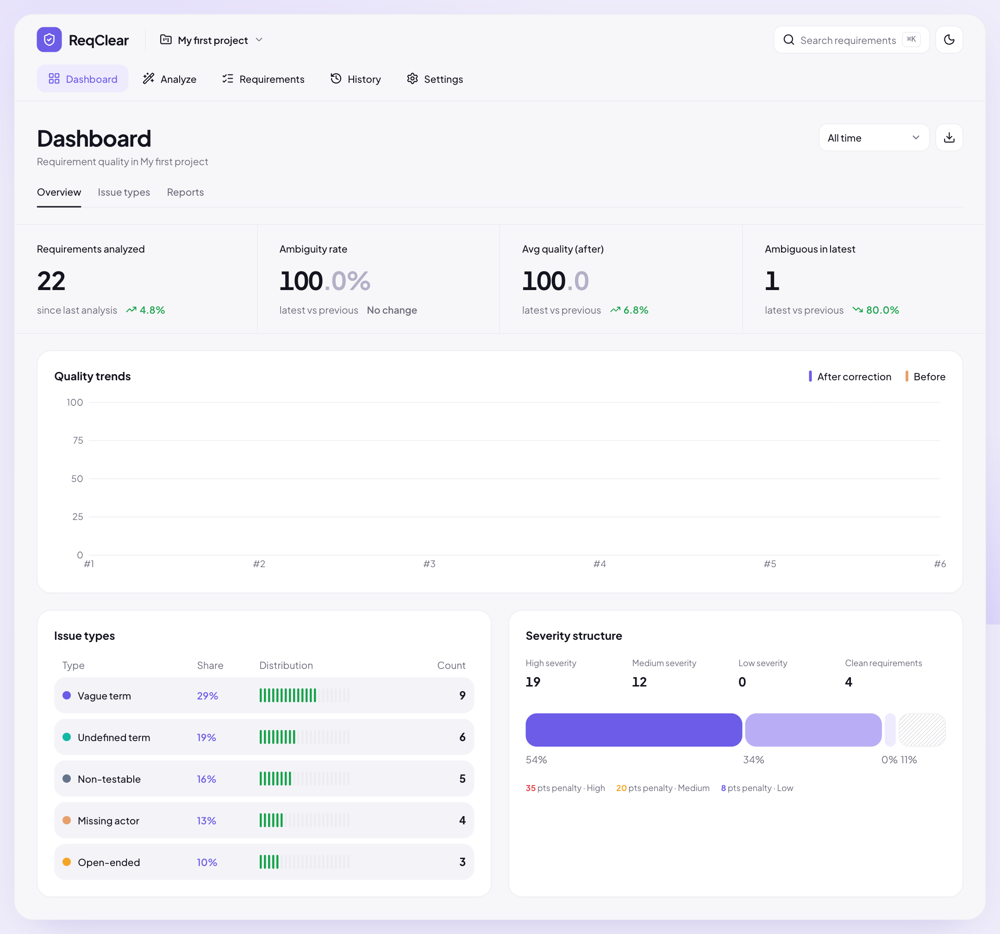
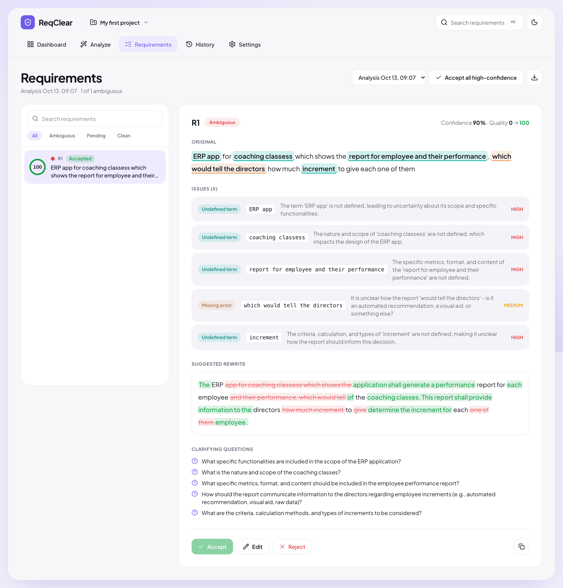
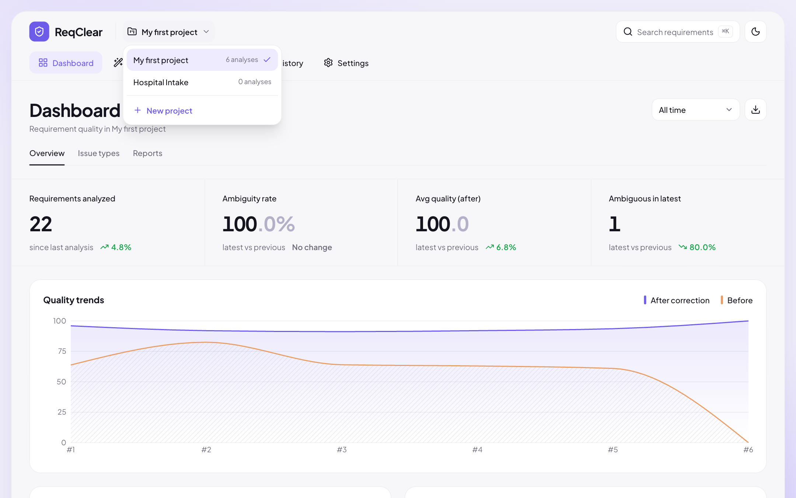
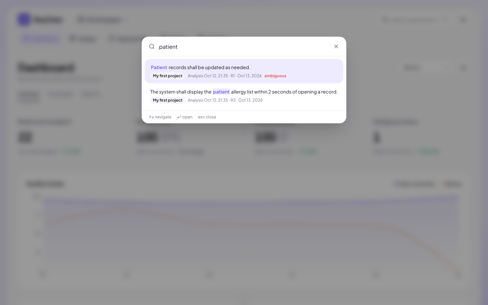
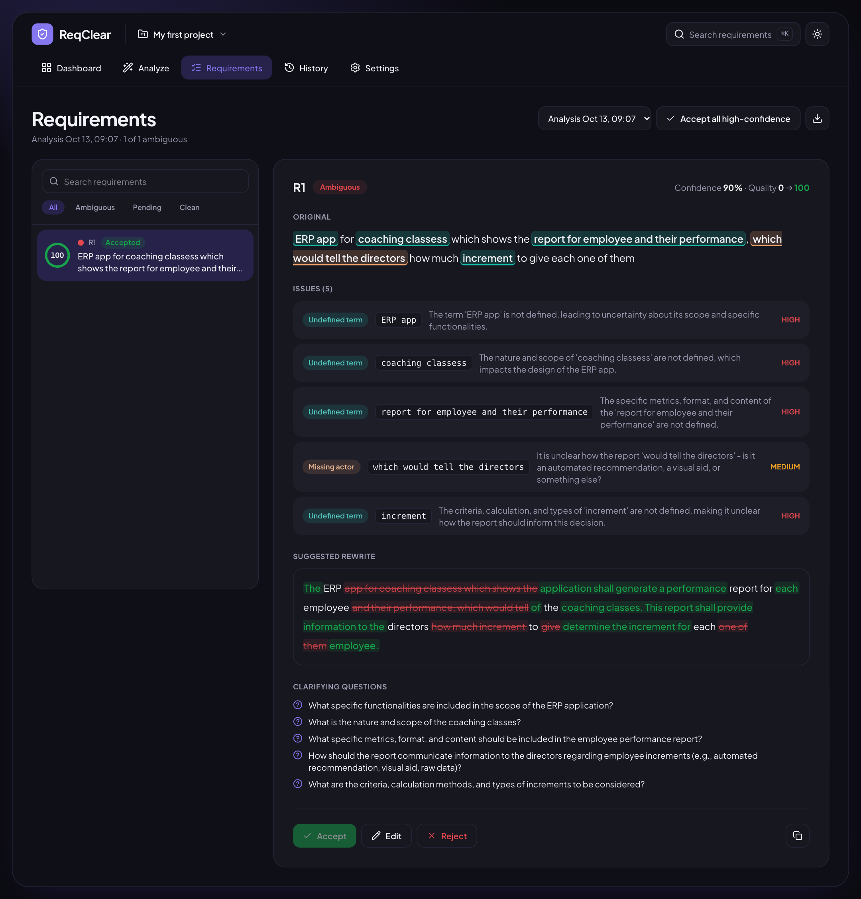
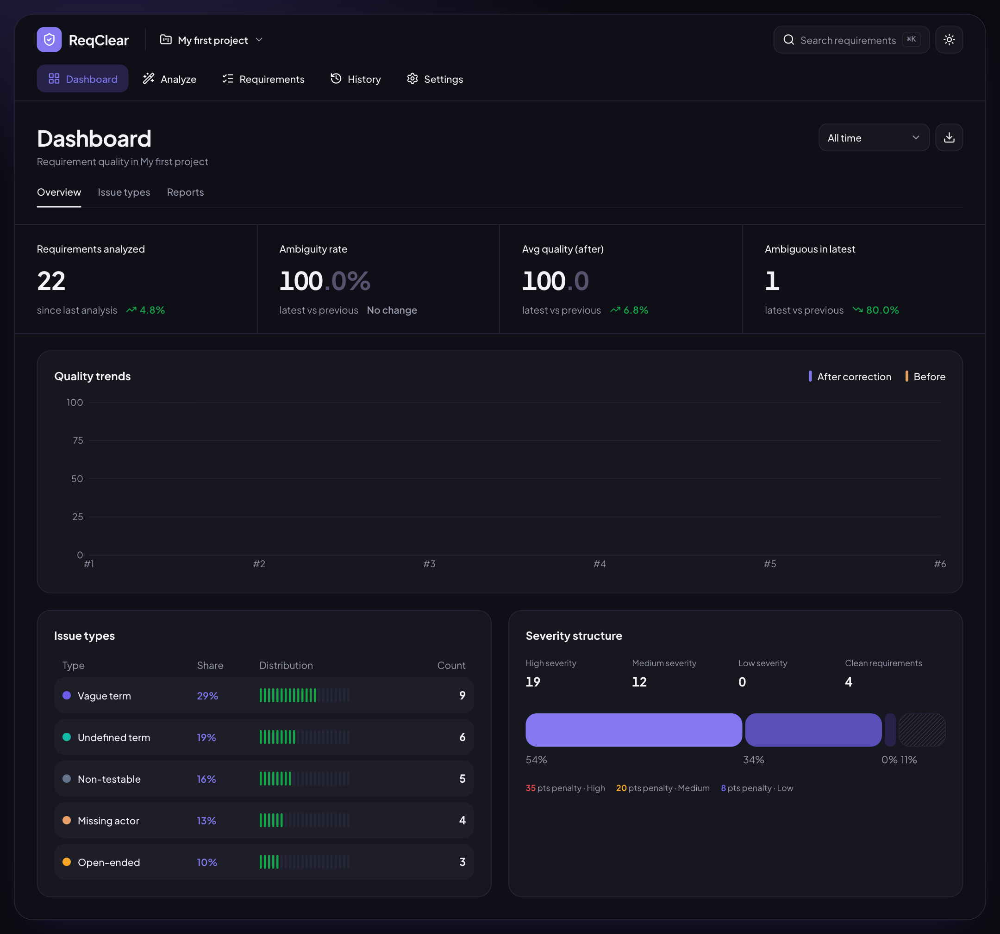
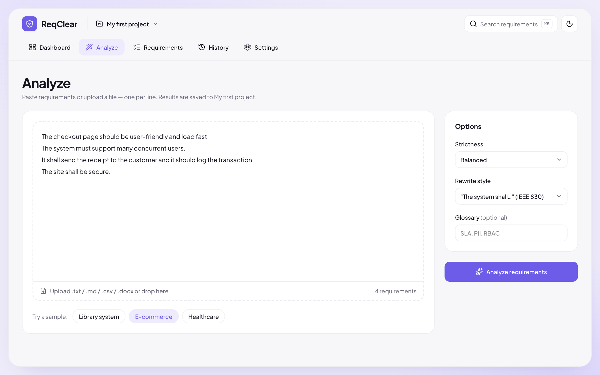
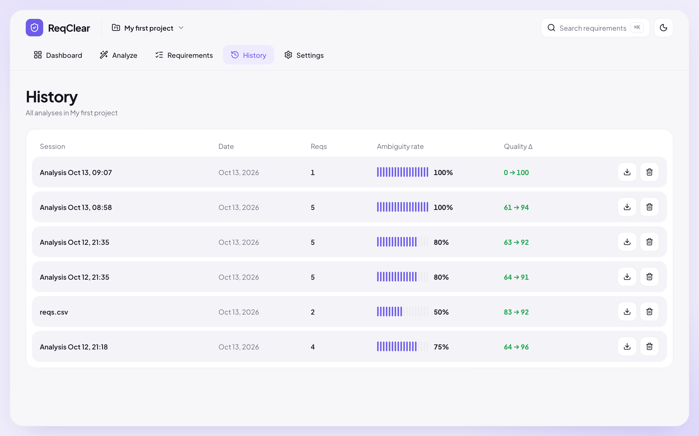
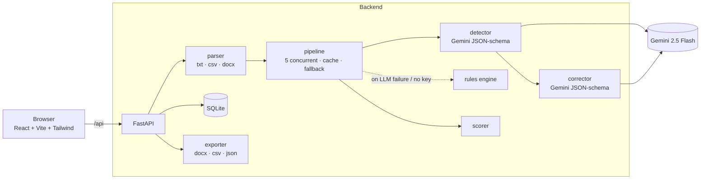

# ReqClear — Automatic Detection and Correction of Ambiguous Software Requirements

ReqClear reads software requirements (pasted text, `.txt`, `.md`, `.csv`, `.docx`), uses an LLM (Gemini 2.5 Flash) to
**detect** ambiguity, **explain** it, and **propose a corrected rewrite**. You review each suggestion
(accept / edit / reject) and export the corrected document.

| Dashboard | Requirements review |
|---|---|
|  |  |

| Projects | Global search (⌘K) |
|---|---|
|  |  |

<details><summary>More screenshots (dark mode, Analyze, History)</summary>





</details>

## Features

- **Projects** — group analyses (e.g. one per product or document). The switcher scopes the Dashboard, Requirements and History to the selected project; rename or delete projects in Settings.
- **Global search** (⌘K / Ctrl+K) — find any requirement, suggested rewrite or accepted correction across all projects and jump straight to it.
- **Dashboard** — KPIs, quality trend, issue-type and severity breakdowns, a per-analysis Reports tab with Word/CSV downloads, a period filter and a CSV summary download.
- **Review workflow** — accept / edit / reject each suggestion, then export the corrected document (Word, CSV, JSON).
- **Settings** — default strictness and rewrite style (saved in the browser), project management, theme.

## What it detects

Ten ambiguity types — vague term, missing actor, unbounded quantifier, referential, lexical, syntactic,
conflicting condition, undefined term, open-ended, non-testable — each with a severity (high / medium / low) and a
0–100 quality score. See [docs/01-taxonomy.md](docs/01-taxonomy.md).

**How well does it work?** On a 30-item held-out set: ambiguity-detection F1 **0.93** (a keyword baseline gets 0.55); 0% of
rewrites invented facts. These numbers come from a small, author-written dataset and a same-family LLM judge — read the caveats in
[docs/04-evaluation.md](docs/04-evaluation.md) before quoting them.

## Quick start

Requirements: [Miniconda](https://docs.conda.io/en/latest/miniconda.html), Node.js ≥ 20, and a free
[Gemini API key](https://aistudio.google.com/apikey).

```bash
./run.sh setup        # creates conda env "req-ambiguity", installs frontend deps, creates backend/.env
# edit backend/.env  →  GEMINI_API_KEY=your-key
./run.sh start        # builds the UI and serves everything on http://localhost:8000
```

Without a key the app still runs in an **offline keyword-rules mode** (detection only, no rewrites); a banner tells you so.

| Command | What it does |
|---|---|
| `./run.sh dev` | Backend (auto-reload, :8000) + Vite dev server (hot reload, :5173) |
| `./run.sh start` | Production-style: one process serves UI + API on :8000 |
| `./run.sh test` | Backend + frontend unit tests |
| `./run.sh e2e` | Playwright browser tests (needs Google Chrome; no Gemini calls) |
| `./run.sh eval` | Evaluation against the real model (~200+ Gemini calls; cached) |

Ports can be changed with `BACKEND_PORT` / `FRONTEND_PORT`. API docs: <http://localhost:8000/docs>.

## Running on Windows

Needs **Python 3.11+** (tested on 3.14) and **Node.js 20.19+** (tested on 24) — no conda required. Use PowerShell from the project folder:

```powershell
powershell -ExecutionPolicy Bypass -File .\run.ps1 setup    # creates .venv, installs backend + frontend packages, creates backend\.env
notepad backend\.env                                        # set GEMINI_API_KEY=your-key
powershell -ExecutionPolicy Bypass -File .\run.ps1 start    # builds the UI, serves everything on http://localhost:8000
```

`run.ps1 dev` runs backend + hot-reload frontend (http://localhost:5173), and `run.ps1 test` runs the unit tests.
The browser (e2e) tests are macOS/Linux-only for now. Manual equivalent if the script gives you trouble:

```powershell
python -m venv .venv
.\.venv\Scripts\python -m pip install -r backend\requirements.txt
cd frontend; npm ci; npm run build; cd ..
copy backend\.env.example backend\.env
cd backend; ..\.venv\Scripts\python -m uvicorn app.main:app --port 8000
```

`backend\.env` and the database are not in git, so a fresh clone starts empty and needs your own API key. A demo document and
presenter notes are in [`demo/`](demo/PRESENTER_NOTES.md).

## Architecture



1. **Parse** — split into numbered single requirements (strips `1.`, `-`, `REQ-3:`), read CSV/DOCX safely (size + zip-bomb guards).
2. **Detect** — one schema-constrained Gemini call per requirement, with the two neighbouring requirements, glossary and keyword hints as context. Character offsets are computed server-side; spans the model invents are discarded.
3. **Correct** — only for ambiguous requirements; the model must not invent facts (uses `[TBD: …]` placeholders + clarifying questions) and must preserve scope and obligation level.
4. **Score** — quality before/after, where "after" re-checks the rewrite with the rule engine.
5. **Review & export** — decisions are stored; exports use the accepted/edited text.

Reliability: automatic retries with backoff, per-requirement fallback to rules, bounded cache, rate limit (20 analyses/min/IP),
200-requirement / 200k-char / 2 MB limits. Security: document text is treated as data — delimiter-tag stripping against prompt
injection, React text rendering (no HTML injection), CSV formula-injection neutralisation, path-traversal-safe static serving.

## Project layout

```
backend/   FastAPI app (app/), tests, evaluation harness (eval/)
frontend/  React + TypeScript UI (src/), Vitest unit tests, Playwright e2e (e2e/)
docs/      taxonomy, API contract, UI spec, evaluation report, screenshots
scripts/   screenshot generator
run.sh     setup / dev / start / test / e2e / eval
environment.yml · backend/requirements*.txt   pinned dependencies
```

## Configuration (`backend/.env`)

| Variable | Default | Meaning |
|---|---|---|
| `GEMINI_API_KEY` | – | Required for LLM mode (also reads `GOOGLE_API_KEY`) |
| `LLM_MODEL` | `gemini-2.5-flash` | Any Gemini model id |
| `THINKING_BUDGET` | `0` | Gemini "thinking" tokens; raise (e.g. 1024) for harder documents at the cost of speed |
| `LLM_ENABLED` | `true` | `false` forces the offline rules engine |
| `DATABASE_URL` | `sqlite:///backend/reqclear.db` | Any SQLAlchemy URL. Older databases are migrated automatically on start (existing analyses go into "My first project"). |

## Testing

`./run.sh test` → 44 backend + 30 frontend tests; `./run.sh e2e` → 16 browser tests. None of them call Gemini. CI-style
reproducibility was verified by building the conda env from `environment.yml` from scratch and running the full suite in it.

## Known limitations

- Single-user: no authentication or user accounts, so don't expose it to the internet as is. Projects are organisational folders, not access boundaries.
- Search scans stored results in Python (fine for thousands of requirements); move to SQLite FTS5 if it needs to scale.
- Deleting a project permanently deletes its analyses (the UI asks for confirmation).
- Rate limiting is in-memory and per process.
- Weakest detection areas: passive-voice "missing actor" judgements, nested and/or logic, and rare double-meaning verbs.
- Rewrites are suggestions — a human should review them, especially where a `[TBD: …]` placeholder is left.
- No Docker image yet.

## Docs

[Taxonomy](docs/01-taxonomy.md) · [API contract](docs/02-api-contract.md) · [UI spec](docs/03-ui-design.md) · [Evaluation](docs/04-evaluation.md)
